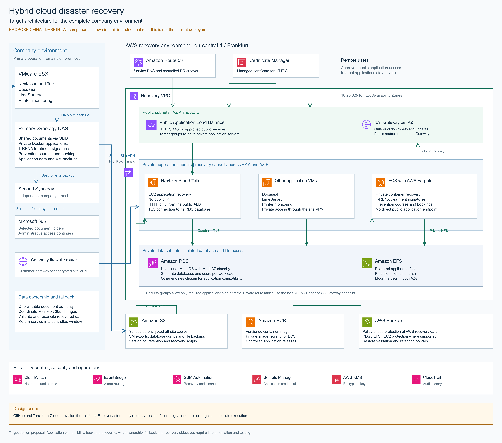

# AWS Hybrid Cloud Disaster Recovery — Terraform Capstone Project

## Overview

This capstone project explores the design and implementation of a secure hybrid cloud disaster recovery solution using AWS and Terraform.

The project is based on a real-world infrastructure scenario in which business-critical applications and documents are primarily hosted on-premises. The goal is to design a disaster recovery architecture that can maintain access to critical services during infrastructure failures while preserving data security, privacy, and consistency.

The AWS environment is implemented as a separate lab environment using test data only. No production or patient data is used.

## Business Problem

The existing on-premises environment already implements a multi-layer backup strategy. Virtual machines and Docker application data are backed up daily to a Synology NAS, and the primary Synology is additionally backed up daily to a second Synology located at another company branch.

Administrative documents are also synchronized with Microsoft 365, providing an additional level of availability for administrative users.

However, backup availability does not automatically provide service availability.

In the event of a major infrastructure failure, critical applications may still require infrastructure to be repaired or replaced, virtual machines and application data to be restored, networking to be reconfigured, and services to be validated before users can resume normal operations.

The project therefore does not aim to replace the existing backup strategy. Instead, it investigates how AWS can complement the current environment by providing a reproducible and partially automated disaster recovery platform for selected business-critical workloads.

A further challenge is data consistency. Documents stored on the Synology NAS are accessed by therapists through Nextcloud SMB External Storage, while administrative users access synchronized versions through Microsoft 365.

During a Synology outage, administrative users may continue modifying documents in Microsoft 365. A disaster recovery environment must therefore avoid creating an independent writable copy that could result in conflicting versions during failback.

## Project Goal

The goal of this project is to design and implement an AWS-based disaster recovery environment that complements the existing on-premises and off-site backup infrastructure.

Rather than replacing the current Synology backup strategy, AWS is used to provide reproducible recovery infrastructure for selected business-critical workloads.

The project explores how Infrastructure as Code and cloud services can reduce recovery complexity and improve service availability following an on-premises infrastructure failure.

The solution focuses on:

- Hybrid cloud architecture
- Infrastructure as Code
- Disaster recovery
- Integration with existing backup processes
- Backup and restore validation
- Network isolation
- Data consistency
- Security and encryption
- Monitoring and alerting
- Controlled failover and failback
- Recovery Time Objectives (RTO)
- Recovery Point Objectives (RPO)

## Current Environment

### Compute

The on-premises environment uses VMware ESXi to host several virtual machines.

Important workloads include:

- Nextcloud
- Docuseal
- LimeSurvey
- Printer monitoring services

### Storage

A Synology NAS provides shared document storage.

The document storage is used by:

- Nextcloud through SMB External Storage
- Microsoft 365 through synchronization

This allows different user groups to access the documents through different platforms.

### Container Workloads

The Synology NAS also hosts Docker applications used for:

- Prevention course management, bookings and planning
- Digital collection of T-RENA treatment signatures

These applications are accessible only from the internal company network and must not be publicly exposed.

## Existing Backup Strategy

The current infrastructure already uses multiple layers of backup and data protection.

### Virtual Machine Backups

Virtual machines running on the VMware ESXi host are backed up daily to the primary Synology NAS.

```text
VMware ESXi
     |
     | Daily Backup
     v
Primary Synology
```

### Docker Application Data

Persistent data used by the Docker applications hosted on the Synology NAS is also backed up daily.

This includes the application data required by:

- T-RENA treatment signature application
- Prevention course management application

### Off-Site Backup

The primary Synology NAS is backed up daily to a second Synology NAS located at another company branch.

```text
                 Main Site

VMware ESXi
     |
     | Daily VM Backup
     v
Primary Synology
     |
     | Daily Off-Site Backup
     v
Secondary Synology
     |
     v
Different Company Branch
```

This provides an additional layer of protection against failures affecting the primary storage system or location.

### Microsoft 365 Synchronization

Selected document folders on the primary Synology are synchronized with Microsoft 365.

This allows administrative users to continue accessing cloud-based copies of these documents even if the primary Synology becomes temporarily unavailable.

```text
Primary Synology
       |
       | Cloud Sync
       v
Microsoft 365
       |
       v
Administration
```

### Backup vs. Disaster Recovery

The existing backup infrastructure protects data, but restoring business services after a major failure can still require several manual recovery steps.

The AWS disaster recovery environment is therefore designed to complement, rather than replace, the existing backup solution.

The project focuses on reducing the time and complexity required to restore selected critical services by combining existing backups with reproducible AWS infrastructure and automated deployment processes.

## Workload Criticality

### Critical Workloads

**Nextcloud**

Provides internal communication through Nextcloud Talk and document access for therapists using mobile devices.

**Docuseal**

Supports digital patient registration and data protection documentation workflows.

**T-RENA Application**

Collects digital treatment signatures and is currently hosted as a private Docker workload.

### Important Workloads

**Prevention Course Application**

Supports course management, bookings and planning.

### Lower-Priority Workloads

**LimeSurvey**

Used for patient satisfaction surveys on dedicated tablets.

**Printer Monitoring**

Monitors printer toner levels and supports toner replacement planning.

These workloads do not require the same recovery priority as the business-critical applications.

## Disaster Scenarios

The project considers several infrastructure failure scenarios.

### ESXi Host Failure

Potentially affects:

- Nextcloud
- Nextcloud Talk
- Docuseal
- LimeSurvey
- Printer monitoring

### Synology Failure

Potentially affects:

- Shared documents
- Nextcloud SMB External Storage
- T-RENA application
- Prevention course application

Administrative users may still have access to synchronized documents through Microsoft 365.

### Complete On-Premises Failure

A larger incident may make both compute and storage infrastructure unavailable.

The AWS disaster recovery environment is designed to provide recovery options for selected critical services.

## Data Consistency Challenge

Document recovery presents an additional challenge.

Under normal operation:

```text
                    Synology
                       |
              Shared Documents
                 /           \
               SMB         Cloud Sync
                |              |
            Nextcloud     Microsoft 365
                |              |
            Therapists    Administration
```

During a Synology outage, Microsoft 365 may remain available and administrative users can continue modifying documents.

Creating an independent writable disaster recovery copy for therapists could therefore result in conflicting versions.

The disaster recovery design must maintain a clearly defined authoritative data source and include a controlled failback procedure.

## Proposed AWS Architecture

The diagram below shows the intended final architecture for all company systems. It includes planned components and does not represent the current deployment status. See Project Status for implemented and tested functionality.



[Download the editable Excalidraw diagram](architecture/final-target-architecture.excalidraw)

The final AWS architecture is currently being designed.

The following list describes services considered for the broader architecture; it is not a list of implemented components. See Project Status for validated MVP functionality. Potential AWS services include:

- Amazon VPC
- Amazon EC2
- Amazon ECS / Fargate
- Amazon ECR
- Amazon S3
- Amazon RDS
- Amazon EFS
- AWS Site-to-Site VPN
- AWS Backup
- AWS KMS
- AWS Secrets Manager
- Amazon CloudWatch
- AWS CloudTrail
- Amazon Route 53

The final selection of services will be based on technical requirements, security, recovery objectives, and cost.

### AWS Region

The disaster recovery environment is deployed in the **eu-central-1 (Frankfurt)** AWS Region.

The project was initially developed in a temporary AWS training sandbox restricted to **us-east-1**. After validating the initial infrastructure and disaster recovery workflow, the project was migrated to a personal AWS account to provide a persistent environment for further recovery testing.

Frankfurt was selected for the current implementation because the simulated company is based in Germany, making it a more appropriate region for the project scenario in terms of geographic proximity and data residency considerations.

The training environment and its Terraform state have been retained separately for historical and testing purposes.

The current lab simulates failure using a separate EC2 instance. It does not yet implement a connection to the real on-premises environment, automated on-premises backup transfer to AWS, or controlled failback.

## Infrastructure as Code

AWS infrastructure is managed using Terraform.

The project uses:

- Terraform
- Terraform Cloud
- GitHub

Infrastructure changes follow the workflow:

```text
GitHub
   |
   v
Terraform Cloud
   |
   v
Terraform Plan
   |
   v
Terraform Apply
   |
   v
AWS
```

The objective is to make the disaster recovery infrastructure reproducible and minimize manual configuration.

## Security Principles

The architecture is guided by the following security objectives. These are not all implemented in the current MVP; in particular, the recovered application currently uses HTTP, runs in a public subnet and does not use centralized secrets management:

- Least-privilege IAM permissions
- Private subnets for internal workloads
- No public exposure of sensitive internal applications
- Encryption at rest and in transit
- Centralized secrets management
- Network segmentation
- Logging and monitoring
- No production patient data in the AWS lab environment

## Disaster Recovery Strategy

The project will evaluate appropriate recovery strategies for each workload rather than applying the same strategy to every service.

The recovery process will cover:

```text
Backup / Replication
        |
        v
Failure Detection
        |
        v
Disaster Recovery Activation
        |
        v
Restore Critical Services
        |
        v
Validate Applications and Data
        |
        v
Temporary AWS Operation
        |
        v
Controlled Failback
        |
        v
Return to On-Premises Operation
```

Recovery Point Objectives (RPO) and Recovery Time Objectives (RTO) will be defined and tested for selected workloads.

## Technologies

- AWS
- Terraform
- Terraform Cloud
- GitHub
- Docker
- VMware
- Synology
- Microsoft 365
- Nextcloud

## Repository Structure

The repository structure will evolve as the implementation progresses.

Planned structure:

```text
.
├── README.md
├── terraform/
├── architecture/
├── documentation/
├── scripts/
└── .github/
```

## Project Status

🚧 **In Progress**

**Current phase: Nextcloud recovery through an Application Load Balancer with a private Amazon RDS database successfully validated**

### Current Progress

- Successfully deployed the AWS disaster recovery infrastructure using Terraform.
- Configured Amazon S3 for Nextcloud backup storage.
- Implemented a custom AWS Systems Manager Automation runbook.
- Configured Amazon EventBridge to detect the simulated on-premises EC2 shutdown.
- Successfully triggered the SSM Automation runbook automatically through EventBridge.
- Automatically launched a new EC2 disaster recovery instance.
- Restored Nextcloud from an Amazon S3 backup using EC2 User Data.
- Successfully restored the Nextcloud database, configuration, applications and user files.
- Verified restored users, files and Nextcloud Talk conversations.
- Confirmed that Nextcloud is accessible and functional after recovery.
- Deployed an Application Load Balancer and automated recovery instance registration in its target group.
- Validated Nextcloud access through the ALB and repeated the sequential duplicate-instance prevention test.
- Deployed a private Amazon RDS for MariaDB instance using Terraform.
- Adapted the recovery script to restore the Nextcloud database to RDS.
- Configured certificate-verified TLS connections to RDS.
- Confirmed the RDS endpoint in the recovered Nextcloud configuration.
- Verified application access, restored users, files and Talk messages.

### Automated Disaster Recovery — Successfully Tested

**Test date:** October 13, 2026

**Status:** Successfully validated.

The automated disaster recovery workflow was tested end-to-end using Amazon EventBridge and AWS Systems Manager Automation.

**Validated recovery workflow:**

1. The simulated on-premises EC2 instance was manually stopped to simulate a server failure.
2. Amazon EventBridge detected the EC2 state change.
3. EventBridge automatically triggered the custom SSM Automation runbook.
4. The runbook successfully launched a new Amazon Linux 2023 EC2 instance.
5. EC2 User Data executed the Nextcloud recovery script.
6. Nextcloud was restored using the backup stored in Amazon S3.
7. The recovered Nextcloud application was successfully accessed.

**Result:**

Automated infrastructure provisioning and Nextcloud application recovery were successfully demonstrated without AWS Lambda or Elastic IP.

**Current limitations:**

- Failure detection is based on the simulated on-premises EC2 state change.
- The duplicate-instance check does not prevent simultaneous automation executions from both creating a recovery instance.
- Recovery instances created before the tagging change are not detected unless the required tag is added.
- Automatic cleanup of temporary recovery instances is not yet implemented.
- RTO and RPO have not yet been formally measured and documented.

### Recovery Instance Check — Successfully Tested

**Test date:** October 15, 2026

The recovery runbook now checks for an existing recovery instance before creating another one.

The check searches the recovery subnet for instances tagged `RecoveryManagedBy = SSMAutomation`. Pending, running, stopping, stopped and shutting-down instances block creation.

**Validated tests:**

1. With no matching recovery instance present, the runbook created a new EC2 instance.
2. The recovered Nextcloud was accessible, and the user confirmed that messages and a file saved before the backup were present.
3. With that recovery instance still present, a second execution followed `RecoveryAlreadyExists` and ended without executing `CreateDRInstance`.

**Result:** Sequential executions were successfully tested: an existing tagged recovery instance prevented another instance from being created. Concurrent executions have not been protected or validated.

### Application Load Balancer — Successfully Tested

**Test date:** October 21, 2026

An internet-facing Application Load Balancer (ALB) was deployed using Terraform.

The ALB uses two public subnets in different Availability Zones and forwards HTTP traffic to the Nextcloud recovery instance through a target group. The recovery instance accepts HTTP traffic only from the ALB security group.

The initial ALB test used MariaDB on the recovery EC2 instance. The subsequent RDS integration test below validated recovery using a separate private database.

**Validated tests:**

1. The updated SSM Automation runbook was started manually.
2. The runbook created a new Amazon Linux 2023 EC2 recovery instance.
3. The instance was automatically registered in the ALB target group.
4. EC2 User Data restored Nextcloud from the Amazon S3 backup.
5. Nextcloud was successfully accessed through the ALB DNS name.
6. Restored users, files and Nextcloud Talk messages were verified.
7. A second execution detected the existing recovery instance and skipped instance creation and target registration.

**Current scope and limitations:**

- The recovery instance still runs in a public subnet; migration to a private subnet is planned.
- Access currently uses HTTP. HTTPS is not yet configured.
- The ALB spans two Availability Zones, but only one recovery instance is created; the application is not highly available.
- The ALB health check requests `/status.php`; application and data recovery were verified separately.
- Successful completion of the SSM runbook does not by itself confirm that application restoration has finished.
- This test validated manual execution of the updated runbook. The EventBridge trigger was validated in the earlier test and has not yet been retested with the ALB workflow.
- The ALB restore script was uploaded manually to S3 as `scripts/restore-nextcloud-alb.sh`. Committing the local script does not update the S3 copy automatically.
- The AWS service-linked role for Elastic Load Balancing was created manually as an account prerequisite.
- The existing-instance branch skips creation; it does not repair missing target registrations or restart stopped recovery instances.

### Amazon RDS Integration — Successfully Tested

**Test date:** October 21, 2026

A private Amazon RDS for MariaDB instance was deployed using Terraform.

**Implemented configuration:**

- MariaDB 10.11.19 on a db.t4g.micro instance.
- Single-AZ deployment with 20 GiB of encrypted gp3 storage.
- Database placed in the private data subnet group, without public access.
- Database access restricted to the Nextcloud EC2 security group on port 3306.
- Automated backups with a one-day retention period, configured for the AWS Free plan.
- Deletion protection enabled.
- Administrative credentials generated by RDS and stored in AWS Secrets Manager.
- A separate Nextcloud database user with privileges limited to the application database.
- Certificate-verified TLS configured for database restoration and application connections.
- READ-COMMITTED transaction isolation and ROW binary logging configured through a custom parameter group.

**Validated recovery workflow:**

1. Terraform provisioned the RDS instance before recovery was started.
2. The updated SSM Automation runbook was executed manually.
3. The runbook created a new EC2 recovery instance and registered it in the ALB target group.
4. EC2 User Data downloaded and executed the RDS recovery script from S3.
5. The script restored Nextcloud files and imported the database backup into RDS.
6. Nextcloud was successfully accessed through the ALB.
7. Restored users, files and Nextcloud Talk messages were verified.
8. The Nextcloud `dbhost` setting was confirmed to match the RDS endpoint.
9. `occ status` reported `installed: true`, `maintenance: false` and `needsDbUpgrade: false`.

**Result:**

Nextcloud application recovery using an ALB, an EC2 application server and a separate private RDS MariaDB database was successfully validated.

**Current scope and limitations:**

- RDS is provisioned in advance by Terraform; the SSM runbook does not create the database instance.
- The recovery EC2 instance still runs in a public subnet.
- The database is Single-AZ and does not provide Multi-AZ failover.
- Browser access through the ALB still uses HTTP.
- The restore script requires an empty destination database and aborts if tables already exist.
- Reusing a populated RDS database for a later recovery requires a separate recovery procedure.
- The new script was uploaded manually as `scripts/restore-nextcloud-rds.sh`; Git pushes do not automatically update this S3 object.
- The EventBridge trigger has not yet been retested with the RDS recovery workflow.
- Sequential duplicate-instance prevention was also successfully retested with the RDS recovery workflow on October 21, 2026. Concurrent execution protection remains unimplemented.
- Automatic cleanup and formal RTO/RPO measurement remain outstanding.

### Next Steps

- Move the Nextcloud recovery instance to a private subnet with the outbound connectivity required for restoration.
- Configure HTTPS for access through the ALB.
- Retest the complete EventBridge-triggered recovery workflow with RDS.

## Disclaimer

This project is an educational proof of concept.

The architecture is inspired by a real business environment, but the AWS implementation uses only test systems and synthetic data.

No real patient or production data is used.